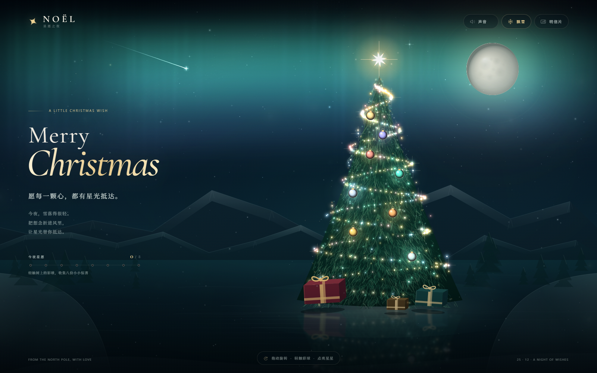
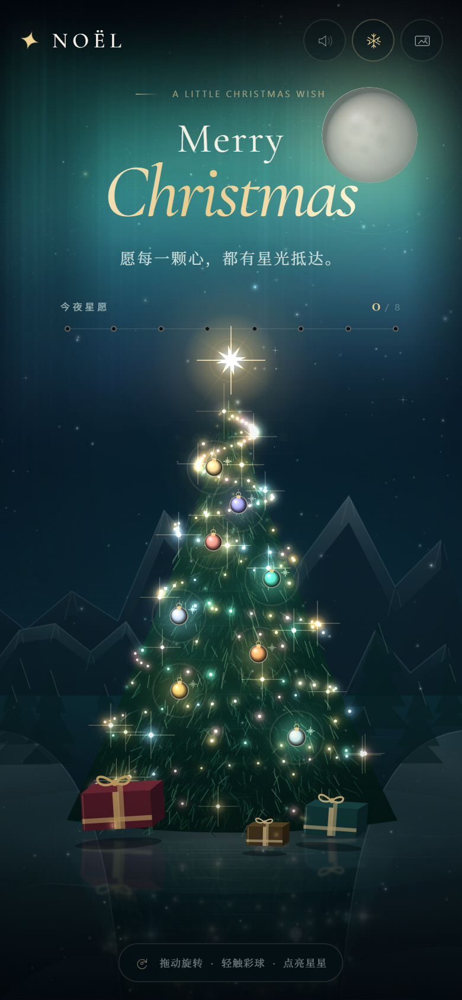
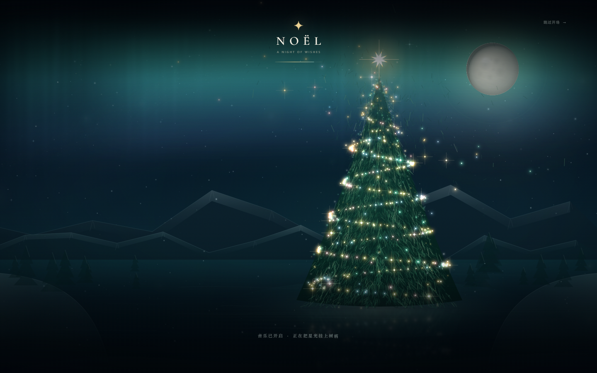
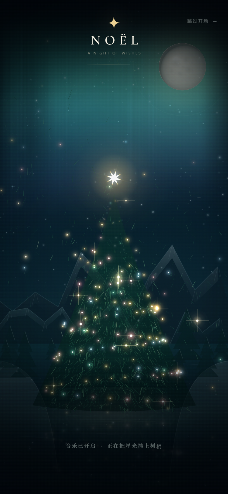
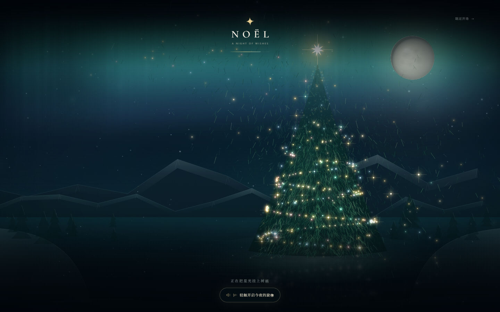
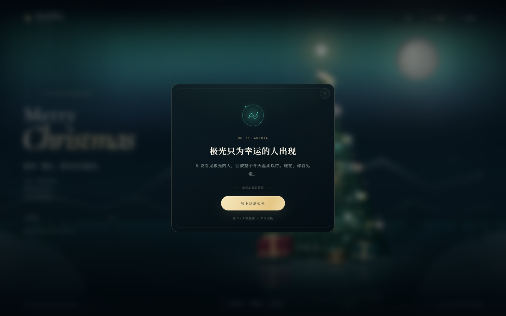
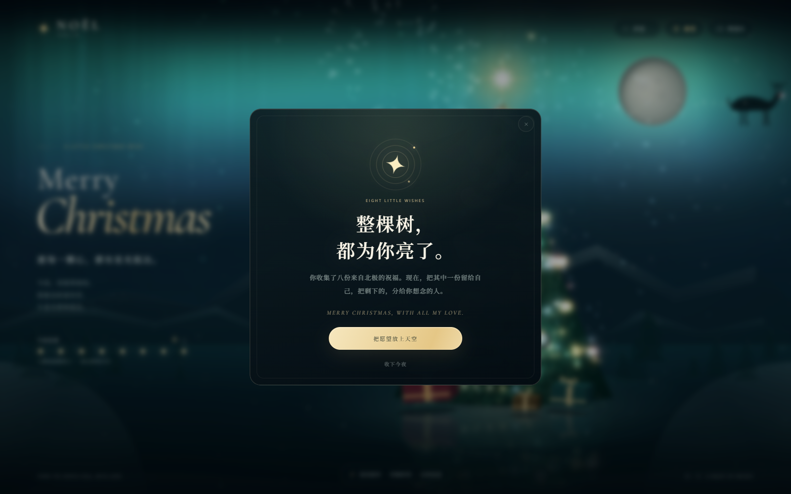

# 星愿圣诞夜 · A Night of Wishes

> 一棵会发光的圣诞树，一场藏在雪夜里的浪漫惊喜。
> 愿每一颗心，都有星光抵达。

一个零依赖、可直接打开的圣诞主题互动网页。用 Canvas 2D 手绘了一片极光雪夜、一棵约九千根针叶的 3D 发光圣诞树、八颗可以逐一点亮的星愿，以及一个会为你生成明信片的许愿仪式。

**在线浏览（GitHub Pages）：** <https://ac1314-520.github.io/christmas-wish/>





---

## 立刻打开

**最省事的方式：双击 [`noel-standalone.html`](noel-standalone.html)。**

这个文件约 800 KB，已经把 CSS、JavaScript 和本地字体全部内嵌，不依赖网络、不需要服务器，发给朋友也能直接打开。

开发时也可以使用源码目录：

```bash
# 在项目目录中启动任意静态服务器
python -m http.server 8080
# 浏览器打开 http://127.0.0.1:8080/
```

> 注意：源码版 `index.html` 从相对路径加载字体；部分浏览器在 `file://` 下会限制本地字体加载。正式分享请使用 standalone 单文件版，或用上面的本地服务器访问。

---

## 开场：整棵树从零组成

每次打开链接，会先看到约 3.2 秒的电影感开场。这不是另一棵“预告树”——画面里就是页面里的这一棵：九千根松针、灯串、彩球和树顶星先在夜色中散成漂浮的星尘，再从树根向上依次归位，最后长成完整的圣诞树；随后标题和界面缓缓浮现。

- 右上角可随时「跳过开场」；
- 页面会在打开时**自动尝试播放音乐**；
- 如果浏览器拦截了有声自动播放，开场底部会出现「轻触开启今夜的旋律」，点一下即可继续；也可以之后点右上角的声音按钮；
- 开启 `prefers-reduced-motion` 时会跳过聚合动画，直接进入正片。



| 手机端开场 | 浏览器拦截声音时的提示 |
| --- | --- |
|  |  |

---

## 今夜有什么

### 场景

- 手绘式冬日夜景：极光、月晕、雪山、雾松、冰湖与雾面倒影。
- 两层不同速度的飘雪，鼠标移动时有轻微景深视差。
- 一颗旋转、呼吸、被八颗星愿围绕的树顶星。
- 树身由 9,000 根程序化针叶与 300 余盏灯组成，底部有缓慢流动的湖面反光。
- 偶尔有流星划过，月亮和流星都可以点击。
- 树下的三只礼物盒也藏着没写进说明书的彩蛋。

### 八颗可以收集的星愿

轻触树上的八颗彩色玻璃球，会打开来自北极的祝福卡片。每一颗球对应一种不同的视觉/听觉效果：

| 星愿 | 交互效果 |
| --- | --- |
| 初雪 | 暴雪短时增强，额外雪花从树梢落下 |
| 铃音 | 风铃般的上升音阶与扩散光环 |
| 烛光 | 树底升起暖金色光晕 |
| 月光 | 月亮脉冲、光环扩散，月光斜落湖面 |
| 极光 | 极光在数秒内增强、变亮 |
| 驯鹿 | 一只驯鹿拖着星尘从夜空横穿而过 |
| 星河 | 金色星尘从树间升起 |
| 流星 | 数颗流星相继划过 |

集齐八颗后，会触发极光烟花与终章卡片 —— **“整棵树，都为你亮了。”**

### 许愿

点击树顶星星，写下愿望。愿望会变成一颗金色小星升入夜空，**只保存在本机 `localStorage`**，不会上传。下次打开页面，它仍在原来的星光位置；点击夜空中的愿望星，可以再次看到那句话。

### 明信片

点击右上角「明信片」，会以当前画面即时生成一张可下载的收藏卡：

- 横屏生成 1600 × 1000 的横向明信片；
- 手机竖屏生成 1200 × 1500 的竖向明信片；
- 自动带上你最近写下的愿望；
- 按当前年份落款，可用「保存明信片」直接下载 JPG。

示例成品：[横版](previews/postcard-desktop.jpg) · [竖版](previews/postcard-mobile.jpg)

### 声音

没有音频文件。页面打开时会自动尝试开始；如果浏览器因自动播放策略拒绝发声，开场会显示一次「轻触开启今夜的旋律」，点它即可解锁并继续播放；之后也可以用右上角的声音按钮开关。若开场结束时声音仍未开启，页面会再给一次轻提示。

播放内容由浏览器实时合成：

- Cmaj9 → Am9 → Fmaj9 → G6/9 的暖色铺底；
- 以五声音阶随机生成的钟琴小旋律；
- 柔和混响，以及驯鹿经过时的雪橇铃。

全部由 Web Audio 振荡器生成。音量已按“笔记本外放也能听见”重新调过；如果觉得太响，点声音按钮即可关闭。

---

## 交互清单与隐藏彩蛋

| 操作 | 结果 |
| --- | --- |
| 打开页面 | 真实的圣诞树从星尘中聚合，并自动尝试开启音乐 |
| 点击「跳过开场」/ `Esc` | 跳过开场，直接进入圣诞夜 |
| 拖动圣诞树 | 带惯性旋转，松开后慢慢回正 |
| 轻触 / 点击八颗彩球 | 打开星愿卡片并收集 |
| 点击树顶星星 | 打开许愿卡 |
| 点击月亮 | 一句月光祝福，同时月亮发光、月光落向湖面 |
| 点击流星 | 接住一颗流星，获得随机祝福 |
| 点击树下的礼物 | 三个礼盒各有一句隐藏祝福 |
| 点击空中的愿望星 | 重读你曾经许下的愿望 |
| 点击飘雪按钮 | 让雪暂时停下 |
| 点击声音按钮 | 开启 / 关闭实时合成音乐 |
| 点击明信片按钮 | 生成当前画面的收藏卡 |
| 键盘输入 `merry` | 触发一场夜空烟花（仅桌面端、未聚焦输入框时） |

八颗球全部收集后，会自动进入终章；如果刷新后还想重看烟花，可以再点任意一颗已收集的彩球，按“再看一次这份祝福”即可。





---

## 项目结构

```text
christmas-wish/
├─ index.html                 # 源码入口（开发者版）
├─ styles.css                 # 视觉系统、响应式布局、弹窗与动效
├─ main.js                    # 八颗星愿数据、许愿、明信片、所有交互
├─ scene.js                   # Canvas 冬日场景、粒子圣诞树与从零聚合动画
├─ audio.js                   # Web Audio 实时合成小夜曲
├─ noel-standalone.html       # 全部内嵌的单文件版（推荐分享）
├─ assets/
│  ├─ fonts/                  # Cormorant Garamond / Noto Serif SC 子集
│  ├─ OFL-CormorantGaramond.txt
│  └─ OFL-NotoSerifSC.txt
├─ previews/                  # 主要预览图与示例明信片
├─ scripts/
│  ├─ build-standalone.mjs    # 重新打包单文件版（Node）
│  ├─ fetch-fonts.mjs         # 可选：重新下载西文字体
│  └─ fetch-cn-font.mjs       # 可选：按当前文案重新生成中文字体子集
└─ README.md
```

### 技术说明

- **没有 Three.js、没有 React、没有构建步骤。** 树是自定义 3D 坐标投影后在 Canvas 2D 上渲染的粒子艺术。
- 每个点按 Y 轴旋转、透视缩放并分深度层渲染；树冠、针叶、灯串、玻璃球、礼物与树顶星被合成到离屏图层，再以低透明度镜像绘制到冰湖上。
- 开场不是播放视频或叠一张动图：`scene.startAssembly()` 直接让同一棵树逐层成形，针叶、灯光、彩球和树顶星各有自己的等待位置与归位节奏。
- 极光是程序生成的柔光纹理，用于表现缓慢移动的窗帘光带；雪山、雪堤、松树、月面与噪声颗粒在 resize 时缓存。
- 帧率自适应：DPR 上限为 2，页面失焦时暂停绘制，减少动效偏好下会降低雪量、关闭自动旋转、流星与驯鹿。
- 无障碍：原生 `<dialog>`、明确的按钮 `aria-label`、键盘可达的八颗彩球、可见焦点样式、`prefers-reduced-motion` 支持。
- 隐私：没有第三方脚本、没有分析工具、没有摄像头权限、没有网络请求；愿望只写入本地存储。

### 兼容性

已在 **Microsoft Edge / Chromium（Playwright 无头模式）** 下验证桌面 1600×1000、平板 768×1024、手机 390×844 / 390×720 / 320×568、横屏 844×390 和离线 `file://` 打开。建议使用较新的 Chrome、Edge、Safari 或 Firefox。

---

## 修改成你的版本

### 1. 换八颗星愿的文案与位置

打开 [`main.js`](main.js)，最上方的 `ORNAMENTS` 数组就是全部内容：

```js
{
  name: '初雪',                 // 彩球 hover 名称
  english: 'FIRST SNOW',       // 卡片顶部编号后的英文
  icon: 'snowflake',           // 复用 index.html 中的 SVG symbol
  color: '#c9f3ef',            // 玻璃球颜色
  effect: 'snowburst',         // snowburst / bell / candle / moon /
                               // aurora / reindeer / stars / meteor
  y: 0.22,                     // 树上的高度，0 底部 → 1 顶部
  angle: -0.55,                // 树面前方的环绕角度
  title: '初雪落在你的肩上',
  quote: '雪落下来……',
  action: '收下这场初雪'
}
```

八颗球会自动生成定位、发光、悬停标签与键盘焦点。改完后页面即可直接使用。

### 2. 换标题和祝福语

编辑 [`index.html`](index.html) 中的 `.title`、`.wishline`、`.poem`；或只改页面标题与 meta description：

```html
<title>你的标题 · Your Title</title>
<meta name="description" content="你的描述">
```

### 3. 换配色

所有颜色集中在 [`styles.css`](styles.css) 顶部的 `:root`：

```css
--gold: #edd293;      /* 金色主调 */
--ice: #b9e4ed;       /* 冰蓝 */
--teal: #8fe7d6;      /* 极光青 */
--night: #02080e;     /* 夜空底色 */
```

树、月亮、极光、灯光的颜色在 `scene.js` 的 `makeSprites`、`buildTree` 与 `makeMoonTexture` 中。

### 4. 调整场景密度

在 [`scene.js`](scene.js) 搜索：

```js
const count = floor((mobile ? 4300 : 9000) ...)  // 针叶数
const lightCount = ...                            // 灯数
const baseCount = this.isMobile ? 128 : 235       // 雪花数
```

### 5. 开场动画

开场直接发生在 [`scene.js`](scene.js)：

- `assemblyDuration` 控制聚合时长（当前 3.1 秒）；
- `buildTree()` 里的 `introX / introY / introDelay` 控制每根针叶、每盏灯开始时漂浮的位置和归位先后；
- `startAssembly()` / `finishAssembly()` 分别开始和立即完成聚合；
- 开场 UI 的显示、跳过和音乐提示在 [`main.js`](main.js) 的 `startIntroSequence()` / `finishIntro()` 中。

### 6. 声音

[`audio.js`](audio.js) 顶部可以改和弦进行、钟琴音阶和音量。搜索 `CHORDS`、`PENTATONIC`、`master.gain...`。浏览器自动播放策略允许时会自动开始；不允许时会在开场中等待一次轻触，不会在之后因为点击页面而自动关掉。

### 7. 隐藏彩蛋文字

在 [`main.js`](main.js) 中搜索 `secretBuffer.endsWith('merry')`，可以把 `merry` 改成你的暗号，并修改上面的彩蛋文案。

### 8. 重新打包单文件

修改源码后，在本目录执行：

```bash
node scripts/build-standalone.mjs
```

会重新生成内嵌 CSS/JS/字体的 `noel-standalone.html`。

> 中文文案若加入当前字体子集之外的新汉字，浏览器会回退到系统宋体显示。若要保持字形一致，可联网执行 `node scripts/fetch-cn-font.mjs` 重新生成子集（该脚本调用 Google Fonts）。

---

## 灵感来源

这是一个原创实现，但在氛围、交互节奏与“树”的表现方式上参考了 GitHub 社区里几类很棒的圣诞项目：

- [rachelfong0320/christmas-tree](https://github.com/rachelfong0320/christmas-tree) — 45,000+ 粒子、金色光晕、悬浮照片与奢华 3D 圣诞树的视觉野心；
- [fuguther/gesture-christmas-tree-2](https://github.com/fuguther/gesture-christmas-tree-2) — 分层粒子树、手势控制的交互想象力，以及烟花与树灯的节奏；
- [cconsta1/christmas-scene](https://github.com/cconsta1/christmas-scene) — 用电影感灯光、雪与一整个场景去讲一个安静瞬间，而不是只画一棵树；
- [haoel/christmas](https://github.com/haoel/christmas) — 单页、直接、带着个人趣味的经典节日网页；
- [jessicacousins/animated-christmas-tree](https://github.com/jessicacousins/animated-christmas-tree) — 摇摇晃晃的挂饰、雪花和纯粹的 CSS 节日快乐。

这里没有复制上述项目的代码。场景、树、音频、许愿、明信片、八颗彩球与全部小彩蛋均为本项目重新设计实现；同时刻意放弃了摄像头和手势识别，以换取更轻、更私密、打开即用的体验。

## 字体与许可

- **Cormorant Garamond** — SIL Open Font License 1.1，许可证见 [`assets/OFL-CormorantGaramond.txt`](assets/OFL-CormorantGaramond.txt)。
- **Noto Serif SC** — SIL Open Font License 1.1，许可证见 [`assets/OFL-NotoSerifSC.txt`](assets/OFL-NotoSerifSC.txt)。
- 页面其余代码、图形与音乐均为本项目原创。你可以自由修改、部署，或用它给某个人一个惊喜。

---

MERRY CHRISTMAS, WITH ALL MY LOVE.
